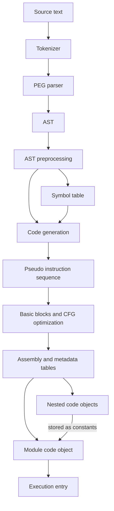

# Shared compilation flow

Both presentation modes begin with the same compiler pipeline. Its output is a code object containing bytecode and metadata, not an AST handed directly to the execution loop.

[run_mod](https://github.com/python/cpython/blob/036d309cf542986a39eeba5ca805b2ec7619731d/Python/pythonrun.c#L1433) connects parsing results to [_PyAST_Compile](https://github.com/python/cpython/blob/036d309cf542986a39eeba5ca805b2ec7619731d/Python/compile.c#L1683). The [compiler overview](https://github.com/python/cpython/blob/036d309cf542986a39eeba5ca805b2ec7619731d/InternalDocs/compiler.md) is useful orientation; the implementation additionally makes AST preprocessing explicit before symbol-table construction.

## Artifacts and transformations

Represent compilation as transformations between inspectable artifacts, with scope information feeding code generation and separate outputs for nested code units.

| Stage | Input and output | Source anchor | Proposed inspection |
| --- | --- | --- | --- |
| Decode and tokenize | Source input becomes tokens, including indentation structure | [_PyTokenizer_Get](https://github.com/python/cpython/blob/036d309cf542986a39eeba5ca805b2ec7619731d/Parser/lexer/lexer.c#L503) | Highlight source span and token kind |
| PEG parsing | Token stream becomes an AST | [_PyParser_ASTFromString](https://github.com/python/cpython/blob/036d309cf542986a39eeba5ca805b2ec7619731d/Parser/peg_api.c#L6), [token acquisition](https://github.com/python/cpython/blob/036d309cf542986a39eeba5ca805b2ec7619731d/Parser/pegen.c#L335) | Expand a statement into AST nodes |
| Preprocessing | Future flags and AST preprocessing prepare the tree | [compiler_setup](https://github.com/python/cpython/blob/036d309cf542986a39eeba5ca805b2ec7619731d/Python/compile.c#L111), [_PyAST_Preprocess](https://github.com/python/cpython/blob/036d309cf542986a39eeba5ca805b2ec7619731d/Python/ast_preprocess.c#L975) | Compare a selected subtree before and after |
| Scope analysis | AST becomes scope and binding information | [_PySymtable_Build](https://github.com/python/cpython/blob/036d309cf542986a39eeba5ca805b2ec7619731d/Python/symtable.c#L423) | Classify local, global, cell, and free names |
| Code generation | AST plus scope information becomes pseudo instructions | [codegen.c](https://github.com/python/cpython/blob/036d309cf542986a39eeba5ca805b2ec7619731d/Python/codegen.c) | Connect an expression to its instruction sequence |
| CFG construction and optimization | Instructions become basic blocks, then an optimized sequence | [optimize_and_assemble_code_unit](https://github.com/python/cpython/blob/036d309cf542986a39eeba5ca805b2ec7619731d/Python/compile.c#L1616) | Follow branch targets and inspect changed blocks |
| Assembly | Resolve instructions, offsets, and tables into a code object | [_PyAssemble_MakeCodeObject](https://github.com/python/cpython/blob/036d309cf542986a39eeba5ca805b2ec7619731d/Python/assemble.c#L804) | Open bytecode, constants, names, positions, and exception table |

The parser requests tokens as needed; an animation that displays all tokens first is a teaching decomposition, not a literal assertion that lexing completes before parsing starts. Scope analysis annotates the compiler's understanding of names; it does not execute assignments or allocate the function's runtime locals.

This diagram focuses on compiler dependencies and nested artifacts. It omits error exits for legibility; tokenize, parse, scope, or compile errors stop that path before a code object is available for execution.

## Code objects are not frames

A code object describes executable code; a frame describes one activation of that code. Function definition, function call, and return must be visibly distinct events.

Compiling a function definition creates its nested code object. Executing the definition creates a function object that associates code with its environment. Calling that function creates an activation with arguments, locals, an instruction position, and an evaluation stack. Repeated calls reuse code but have distinct activations. See the [code object layout](https://github.com/python/cpython/blob/036d309cf542986a39eeba5ca805b2ec7619731d/Include/cpython/code.h), [function layout](https://github.com/python/cpython/blob/036d309cf542986a39eeba5ca805b2ec7619731d/Include/cpython/funcobject.h), and [[execution#Adaptive execution]].

Make the code-object display a container, not just a strip of opcodes: include constants, name references, local/cell/free variable metadata, stack capacity, source locations, and exception-table data. Cache entries and instruction arguments occupy space too; one displayed instruction need not equal one source expression or one two-byte code unit.

## Boundaries for the first narrative

The first walkthrough starts from source text and ends at a call result. Import caching, compiler bootstrap, and startup are optional expansions, not mandatory stations on every execution path.

Do not put `.pyc` writing between every compilation and execution. Import machinery can load valid cached bytecode, while executing an ordinary source script does not require a persistent bytecode-cache step. A later import chapter can branch at the code-object input; see [importlib's cache handling](https://github.com/python/cpython/blob/036d309cf542986a39eeba5ca805b2ec7619731d/Lib/importlib/_bootstrap_external.py).

Keep compiler optimizations separate from adaptive specialization and JIT optimization. They occur at different times and operate on different representations; all three deserve distinct labels even if they share a visual transformation motif.
