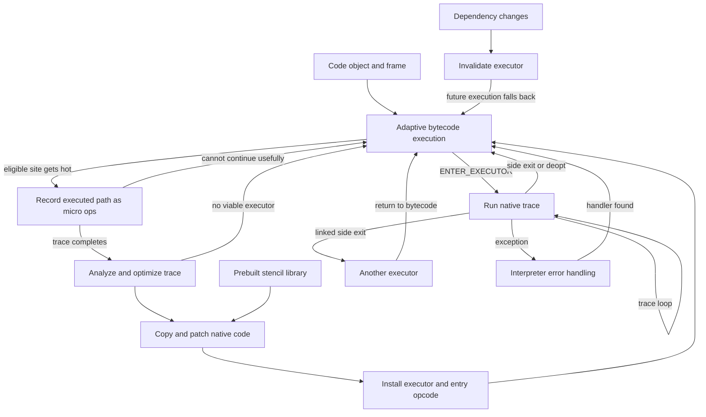

# Interpreter and JIT execution

The adaptive interpreter is the shared execution foundation. With the experimental JIT enabled, hot paths can be recorded, optimized, and installed as native executors that cooperate with that interpreter.

The [JIT internal guide](https://github.com/python/cpython/blob/036d309cf542986a39eeba5ca805b2ec7619731d/InternalDocs/jit.md) explains the architecture. The following flows are checked against the current bytecode definitions, optimizer, and native emitter rather than assuming an older release's JIT design.

## Adaptive execution

Show the current frame, its instruction pointer, local slots, evaluation stack, and references to objects. Bytecode dispatch changes this state; the frame stack changes on calls and returns.

[PyEval_EvalCode](https://github.com/python/cpython/blob/036d309cf542986a39eeba5ca805b2ec7619731d/Python/ceval.c#L658) provides an execution entry and [_PyEval_EvalFrameDefault](https://github.com/python/cpython/blob/036d309cf542986a39eeba5ca805b2ec7619731d/Python/ceval.c#L1234) implements default frame evaluation. The [_PyInterpreterFrame layout](https://github.com/python/cpython/blob/036d309cf542986a39eeba5ca805b2ec7619731d/Include/internal/pycore_interpframe_structs.h#L23) includes previous-frame linkage, instruction and stack pointers, and local/stack slots using stack references. Do not depict these slots as copied heap objects or assume every internal reference is a raw owning pointer.

For an expression such as `a + b`, show references loaded into the evaluation stack, operands consumed by the operation, and a result reference made available. Exact opcodes, fused operations, and intermediate stack states must come from the chosen build. The evaluation stack inside one frame is distinct from the stack of activations. Common Python-to-Python calls switch frames inside the evaluator; they need not recursively enter a new C evaluator call for every Python call.

Specialization belongs in the regular mode. [_Py_Specialize_BinaryOp](https://github.com/python/cpython/blob/036d309cf542986a39eeba5ca805b2ec7619731d/Python/specialize.c#L2339) can select an integer-add implementation, and the [integer-add opcode definition](https://github.com/python/cpython/blob/036d309cf542986a39eeba5ca805b2ec7619731d/Python/bytecodes.c#L712) includes type guards. Inline caches and counters guide specialization; guard misses permit fallback. Present this as adaptation of an instruction site, not a permanent type assigned to a Python variable. Use the [interpreter guide](https://github.com/python/cpython/blob/036d309cf542986a39eeba5ca805b2ec7619731d/InternalDocs/interpreter.md) for cache and dispatch context.

## JIT recording and installation

JIT execution begins in the adaptive interpreter. Hotness can initiate trace recording, but recording and compilation can decline or fail to produce an executor.

The [_JIT operation](https://github.com/python/cpython/blob/036d309cf542986a39eeba5ca805b2ec7619731d/Python/bytecodes.c#L3486) checks a counter at eligible loop-back or resume sites and calls [_PyJit_TryInitializeTracing](https://github.com/python/cpython/blob/036d309cf542986a39eeba5ca805b2ec7619731d/Python/optimizer.c#L1117). Recording interleaves with actual interpreter execution: [TRACE_RECORD](https://github.com/python/cpython/blob/036d309cf542986a39eeba5ca805b2ec7619731d/Python/bytecodes.c#L6571) translates executed bytecodes into micro-ops and records required live values. It is not a static translation of an entire function, and one bytecode may expand into several micro-ops.

[stop_tracing_and_jit](https://github.com/python/cpython/blob/036d309cf542986a39eeba5ca805b2ec7619731d/Python/ceval.c#L1090) invokes [_PyOptimizer_Optimize](https://github.com/python/cpython/blob/036d309cf542986a39eeba5ca805b2ec7619731d/Python/optimizer.c#L129). The optimizer's [uop_optimize](https://github.com/python/cpython/blob/036d309cf542986a39eeba5ca805b2ec7619731d/Python/optimizer.c#L1648) calls [_Py_uop_analyze_and_optimize](https://github.com/python/cpython/blob/036d309cf542986a39eeba5ca805b2ec7619731d/Python/optimizer_analysis.c#L805), which performs data-flow analysis and removes unneeded operations. It constructs an executor, with native compilation under the native-JIT build flag. Show a before/after trace with the reason for each illustrated deletion; do not invent eliminated guards without capture evidence.

[insert_executor](https://github.com/python/cpython/blob/036d309cf542986a39eeba5ca805b2ec7619731d/Python/optimizer.c#L93) stores an executor on the code object and replaces the entry instruction with `ENTER_EXECUTOR`. [ENTER_EXECUTOR](https://github.com/python/cpython/blob/036d309cf542986a39eeba5ca805b2ec7619731d/Python/bytecodes.c#L3550) selects the executor and can remain in tier 1 when pending work or instrumentation requires it. The entire code object does not turn into native code.

Edges show possible control transfers, not a guarantee that every run visits every state. Compilation errors also return through error handling; the diagram's no-viable-executor edge describes a declined optimization. Hotness and trace limits depend on configuration, and animation time must not be presented as measured CPU time.

## Copy and patch has two timescales

LLVM prepares reusable machine-code stencils when building CPython. Runtime compilation selects and patches those stencils for a specific optimized trace.

The [JIT build tools](https://github.com/python/cpython/blob/036d309cf542986a39eeba5ca805b2ec7619731d/Tools/jit/README.md) and [template](https://github.com/python/cpython/blob/036d309cf542986a39eeba5ca805b2ec7619731d/Tools/jit/template.c) describe build-time preparation from micro-op implementations. Represent this as an optional build-time inset feeding a stencil library, not an LLVM compiler launched each time user code becomes hot.

At runtime, [_PyJIT_Compile](https://github.com/python/cpython/blob/036d309cf542986a39eeba5ca805b2ec7619731d/Python/jit.c#L644) computes code and data sizes, allocates memory, emits stencil groups with trace-specific information, marks the memory executable, and attaches its address to the executor. The resulting native code still implements Python semantics and can access Python runtime helpers and objects. Avoid depicting a universal conversion of all Python objects into unboxed machine values.

The micro-op interpreter is an alternative executor backend useful for debugging. It shares trace formation and optimization concepts but dispatches micro-ops instead of executing emitted native instructions. Treat it as an optional explanatory lens within the JIT chapter, not a third main presentation mode.

## Exits and invalidation

Separate alternate-path exits, deoptimization, exceptions, and invalidation. They preserve correct execution in different circumstances and should not all be shown as a crash or a discarded function.

The [JIT guide's exit distinction](https://github.com/python/cpython/blob/036d309cf542986a39eeba5ca805b2ec7619731d/InternalDocs/jit.md) separates side exits that can seed additional traces from deopts that do not initiate recording that way. [_COLD_EXIT](https://github.com/python/cpython/blob/036d309cf542986a39eeba5ca805b2ec7619731d/Python/bytecodes.c#L6228) can return to bytecode, connect to an existing executor, or initiate recording as the exit becomes hot. A loop finishing or a different branch being taken is normal control flow.

[Executor invalidation](https://github.com/python/cpython/blob/036d309cf542986a39eeba5ca805b2ec7619731d/Python/optimizer.c#L1876) is a dependency/lifetime event rather than merely a failed input-type guard. For a changed assumption, show the affected executor becoming unavailable and execution continuing through a valid path. An individual guard miss need not invalidate or destroy the whole executor.

At a return to bytecode, show the continuation instruction and synchronized frame/stack state. For exceptions, show entry into interpreter error handling and then a handler or propagation. Do not resume at an arbitrary source line or reset the function to its beginning.
